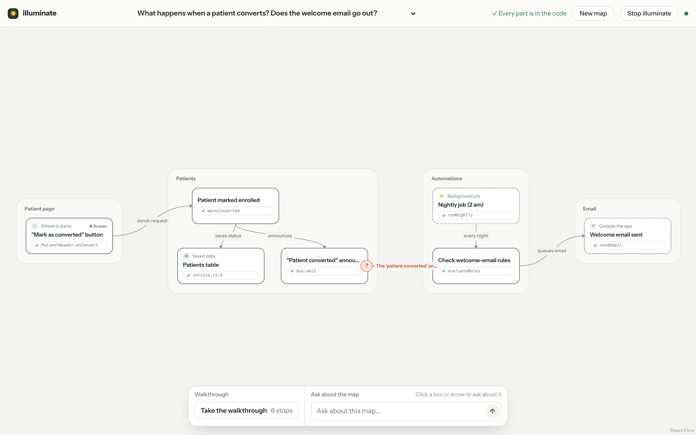
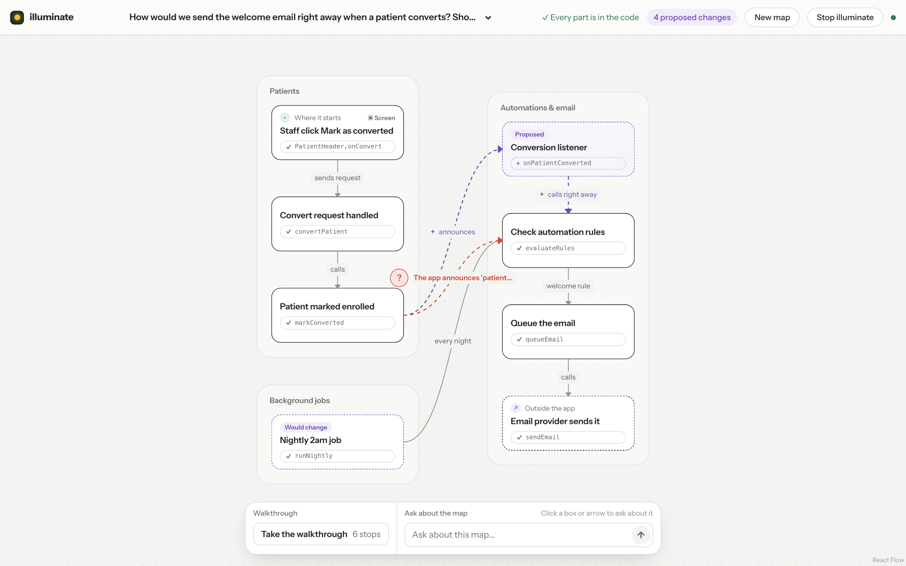

#  illuminate

Ask Claude Code how your code works and get a map you can point at. Claude reads the repo and draws the answer as
boxes and arrows in your browser. A plain program then checks every box and arrow against the real code before you see
it, so the map can't show something that isn't there.

Using Codex? Support is in [preview](#codex-preview): still rough, and best in the ChatGPT desktop app.



Design: [Codemap v1 Design](https://claude.ai/artifact/55L8tokprGe61qtfpDXJ5h).

## Install

You need Claude Code 2.1.275 or later (`claude --version`) and Node 20.19 or later (`node --version`). There is no API
key to set up: illuminate uses your own Claude Code session and sign-in.

**1. Install the plugin.** In a terminal:

```
claude plugin install illuminate --marketplace johnz4021/illuminate
```

Or inside Claude Code:

```
/plugin marketplace add johnz4021/illuminate
/plugin install illuminate@illuminate
```

**2. Restart Claude Code.**

**3. Ask how something works**, in any repo:

> What happens when a user signs up?

Or start with `/illuminate`. A map opens in your browser after about a minute.

### Or have your agent install it

Paste this into Claude Code:

```
Install the illuminate plugin for Claude Code for me (https://github.com/johnz4021/illuminate):
1. Check `claude --version` is 2.1.275 or later and `node --version` is 20.19 or later. If Claude Code is older,
   tell me to run `claude update` myself and stop. If Node is missing or older, tell me, and offer to install it
   with what my machine already uses (nvm, fnm, volta, asdf or Homebrew); only do it if I say yes.
2. Run `claude plugin install illuminate --marketplace johnz4021/illuminate`. If it fails because the git clone
   timed out, run it once more with CLAUDE_CODE_PLUGIN_GIT_TIMEOUT_MS=300000 set.
3. Run `claude plugin list` and check illuminate is there and enabled.
4. Tell me to restart Claude Code, and suggest a first question to ask about this repo.
```

For Codex, see [Codex (preview)](#codex-preview).

### If it doesn't work

- **"Git clone timed out" while installing:** Claude Code downloads the plugin from GitHub, and a slow connection can
  time out. Run the command again, or give it longer: `CLAUDE_CODE_PLUGIN_GIT_TIMEOUT_MS=300000 claude plugin install
  illuminate --marketplace johnz4021/illuminate`.
- **Claude doesn't make a map after the restart:** run `/mcp` in Claude Code. It shows whether the illuminate server
  started, and its error if it didn't. The usual cause is Node: ask for a map anyway, and Claude checks Node, offers to
  install or update it, and tells you what to restart.
- **`/mcp` says illuminate "failed" or "Connection closed", but Node and Claude Code are new enough:** the first time
  Claude Code starts illuminate, `npx` has to download it, and on a slow connection that can take longer than Claude
  Code waits. Download it once yourself in a terminal (it starts, then exits straight away):

  ```
  npx -y @johnz4021/illuminate@0.5.10 channel </dev/null
  ```

  Then, in Claude Code, run `/mcp`, choose **plugin:illuminate:illuminate** and **Reconnect** (or restart Claude Code).
  It starts quickly from then on. If that command prints an error instead, that error is the real problem: please
  [open an issue](https://github.com/johnz4021/illuminate/issues) with it. An error about a missing
  `@oxc-parser/binding-…` usually means npm's cache is damaged: delete `~/.npm/_npx` and run the command again.
  Versions before 0.5.10 downloaded about 170 MB the first time, so this happened much more often; update with the
  steps below.

## Updating

Turn on auto-update once, and Claude Code keeps illuminate current by itself: `/plugin`, then **Marketplaces**,
**illuminate**, **Enable auto-update**. When it fetches a new version it says "Plugin updated"; restart Claude Code to
use it.

Or update by hand (or ask Claude to run these), then restart Claude Code:

```
claude plugin marketplace update illuminate
claude plugin update illuminate@illuminate
```

When a newer version is out, illuminate mentions it with your first map, at most once a day. To find out, it asks npm
for the latest version number of `@johnz4021/illuminate` and sends nothing else. Set `ILLUMINATE_NO_UPDATE_CHECK=1` to
turn that off.

## What you can ask

Ask in plain words, or start with `/illuminate`. A map opens in your browser after about a minute. The screenshots
below are real maps of a small demo app (a clinic's patient system).

### 1. How something works

> What happens when a patient converts? Does the welcome email go out?

Claude follows the flow from where it starts to where it ends, across files. If something on the way should connect
and doesn't, the map shows it as a red dashed arrow, with the search that proves nothing is there. That is the map at
the top of this page: the app announces the conversion, and nothing is listening.

### 2. What a change did

> What did you just change?

The map shows the code as it is now, compared with a commit (the last one, unless you name another). What is new is
green, what is different is amber, and what was deleted is struck through in red. illuminate works those out itself
from the two versions. The switch at the top left shows the code before, after, or both.


Good for reading what an agent did after a long task. It compares with a commit, so work you hadn't committed before
the task counts as changed too.

### 3. A user journey

> Show me the user journey: what does staff go through to convert a patient?

Asked what a person sees or does, Claude draws screens, actions and choices with no code on the boxes. The main path
runs left to right on one line, and the other ways through (a note written instead, going back to the lists, no email
sent) branch off below it, each in its own colour, named in a key. A screen can show a wireframe of its page, drawn
from the code, with the part the step is about marked. Nothing has to be running.


When the answer is parties taking turns (a login through Google, a payment and its webhook, a swap across two
chains), Claude draws a timeline instead: a lane for each party, and the steps left to right in the order they happen,
so you can see who does what when.

### 4. A change before it's made

> How would we send the welcome email right away when a patient converts? Show me a plan.

Claude draws the code as it is, checked, with the proposal on top in violet: new boxes and arrows dashed, and what
would change marked. Nothing is edited. After the change is built, reopen the map and illuminate marks which proposed
parts are now in the code.



## On the map

- **Take the walkthrough.** A few stops, starting with the answer to your question.
- **Click any box or arrow** to see what it does and the code behind it: the function itself, with the lines the map
  relies on marked and a link that opens the file in your editor at that line.
- **Ask a follow-up** in the box at the bottom, or select something first and ask about that. The answer lights up the
  part of the map it's about, and when seeing it drawn helps, Claude adds it to the map, checked like the rest. When the question is about the code itself ("what's in this payload?"), the answer comes
  with the lines that show it, each with a note.
- **Ask for a fix.** Claude proposes one, drawn on the map next to the exact change. Nothing is edited until you
  approve it.

The top bar says whether the map still matches the code ("Every part is in the code"). The check proves each part is
real; it doesn't prove the map covers everything.

## How it runs in Claude Code

illuminate runs as an MCP server in Claude Code: your session does the reading and writing, and illuminate checks every
claim and draws the map. Questions you ask on the map go to that same session, and the answers come back to the map.

Without the plugin: `claude mcp add --scope user illuminate -- npx -y @johnz4021/illuminate@latest channel` (`@latest`
makes npx look for the newest version each time Claude Code starts illuminate; without it, npx can keep running the one
it downloaded first). From a checkout of
this repo instead (for working on illuminate):

```
npm i && npm run build
claude mcp add --scope user illuminate -- node "$PWD/packages/server/bin/illuminate.mjs" channel
```

Once a map is ready, Claude keeps one `illuminate_listen` call open: after two minutes Claude Code moves it to the
background and gives you your terminal back, and when you ask on the map it wakes the session with your question. The
session has to stay open for that. Every 25 minutes or so the call returns and Claude quietly starts another (Claude
Code drops a call that has been quiet for 30 minutes); after about two hours with no questions, illuminate stops
listening. If a question on the map says Claude Code isn't listening, tell Claude "listen to illuminate". To skip
approving each illuminate tool call, allow its tools when Claude Code asks (`mcp__plugin_illuminate_illuminate__*` from
the plugin, `mcp__illuminate__*` otherwise).

Moving long tool calls to the background is on by default; if you've turned it off (`CLAUDE_CODE_MCP_AUTO_BACKGROUND_MS=0`),
listening holds your terminal until you ask on the map. Starting Claude Code with
`--dangerously-load-development-channels server:illuminate` is optional: it also pushes questions into the session
when nothing is listening.

Differences from the CLI: Claude works with your session's own tools and permissions, so the read-only tools and the
secret-file guard of the Agent SDK session aren't enforced, only asked for. Everything shown still passes the checker,
and fixes are still applied by illuminate only after you approve them.

## Codex (preview)

illuminate also runs in Codex, as a preview: it works, but it's still rough, and it's best in the ChatGPT desktop app,
whose built-in browser shows the map beside the chat. If you'd use it in Codex, say so (and what got in the way) on
[the Codex issue](https://github.com/johnz4021/illuminate/issues/1): that's where it's tracked, and where it'll be announced when it's ready.

Your Codex session does the reading and writing, and illuminate checks every claim and draws the map, as in Claude
Code. Install it as a plugin:

```
codex plugin marketplace add johnz4021/illuminate
codex plugin add illuminate@illuminate
```

Then restart Codex. Or paste this into Codex:

```
Install the illuminate plugin for Codex for me (https://github.com/johnz4021/illuminate):
1. Check `node --version` is 20.19 or later. If Node is missing or older, tell me and stop.
2. Run `codex plugin marketplace add johnz4021/illuminate`, then `codex plugin add illuminate@illuminate`.
3. Tell me to restart Codex, then to ask for a map in the chat.
```

Or add only the server: `codex mcp add illuminate -- npx -y @johnz4021/illuminate@latest channel`. From a checkout of
this repo: `npm i && npm run build`, then `codex mcp add illuminate -- node "$PWD/packages/server/bin/illuminate.mjs" channel`.
To update the plugin, refresh its marketplace with `codex plugin marketplace upgrade`; with `@latest`, restart Codex.

Then ask for a map in the chat ("map what happens when a user signs up"). Codex gives you the map's link and opens it
in the built-in browser if it can; otherwise click the link. The first time, the browser asks whether to open
`127.0.0.1:4317`. illuminate keeps that port when it's free, so you're asked once. If 4317 is taken, it uses the next
port and says so.

Ask about the map in the Codex chat, not on the page. Codex can't be woken from the page, so the page's question box
points to the chat instead. Click a box or arrow first: the page tells illuminate what you selected (or which
walkthrough step is on screen), and your question in the chat is about that. Codex hands the question to illuminate,
does the work, illuminate checks the answer and lights up what it's about on the map, and Codex posts the checked
answer in the chat, with the lines of code it points at. The page has no conversation column in Codex; it opens only for
something to do there: approving a fix (that still happens on the page), or taking up the offer of a new map.

In the Codex CLI or IDE extension there's no built-in browser: open the link in your own browser, and in the chat name
the box you mean (or select it on the page first; that still works).

What's different from Claude Code:
- Codex has no background tool calls, so nothing listens for questions asked on the page. If you start work from the
  page (a new map, or "Just answer in words"), the page tells you to say "carry on with illuminate" in the chat.
- Codex cuts off a tool call after a minute by default (`tool_timeout_sec`), so illuminate's calls return within about 40
  seconds and Codex picks up where it left off. Long requests come in parts.
- illuminate's tools say they change nothing outside `.illuminate/` and reach nothing beyond this machine, so Codex
  doesn't ask before each one.
- The map's link carries illuminate's access token, so it ends up in your Codex chat history. It only works on your
  machine, and only while illuminate is running.
- As in Claude Code, read-only and the secret-file guard are instructions to Codex, not enforced. Everything shown still
  passes the checker, and fixes are applied only after you approve them.

## Use it from the command line (API key)

```
npm i
npm run build                                              # the viewer
npm run illume -- "What happens when a user signs up?" --repo /path/to/your/repo
```

It prints a link (`http://127.0.0.1:4317/m/<id>?t=<token>`) and opens it. illuminate stops on its own about 30 seconds after
you close its last tab (never while Claude is working), or when you press Stop illuminate on the page. Maps are saved in the target repo under
`.illuminate/maps/`; commit them to share. Other commands:

```
npm run illume -- open --repo <dir>            # maps already made in that repo
npm run illume -- check <map-id> --repo <dir>  # re-check a saved map against the code (exit 1 if a claim fails)
```

Options: `--port <n>` (default 4317), `--no-open`, `--model <id>` (default `claude-opus-5-5`, or `ILLUMINATE_MODEL`).

The published package runs the CLI too, but leaves out the Agent SDK it needs to call Claude on its own (it brings a
whole Claude Code binary, about 250 MB, which the plugin doesn't need). Install the two together:
`npm i -g @johnz4021/illuminate @anthropic-ai/claude-agent-sdk@0.3.296`, then `illume "<question>"`. A checkout
already has it.

Claude access: an `ANTHROPIC_API_KEY` (a logged-in Claude Code also works for your own use, but don't hand illuminate to
others that way: Anthropic doesn't allow products on the Agent SDK to use people's claude.ai sign-in). To keep the key in a file,
`cp .env.example .env` at the root of this checkout and fill it in; the CLI loads it, and your shell's variables win.

To put `illuminate` on your PATH: `npm link -w @illuminate/server`.

### From a coding agent

`plugin/skills/illuminate/SKILL.md` is a skill in the standard `SKILL.md` format (the plugin installs it in Claude Code). Copy the `illuminate` folder into
`.claude/skills/` (Claude Code), `.agents/skills/` (Codex, Gemini CLI) or `.cursor/skills/` (Cursor). Your agent then
runs illuminate when you ask how something works, and hands you the link.

### Try it without a model

```
npm run preview
```

The real server and viewer on a throwaway copy of the care-app fixture, with a scripted stand-in for Claude. Nothing
is sent anywhere. Useful for UI work and demos.

### Screens on the map

When a flow starts from something you can see (a button, a form), Claude can put a picture of that screen on the box,
with the button marked. It decides case by case; backend-only maps get none. The usual picture is a wireframe of the
whole page, drawn from the code: its parts (top bar, sidebar, main area) with the one the step is about marked.
Nothing has to be running for that. illuminate checks that each part really belongs to the page and that its text is
in the code; where the parts sit is Claude's reading, so the wireframe says it is approximate. If your app is already
running on localhost, or the repo has an HTML file, illuminate can screenshot it instead with the Chrome you already
have, in a clean profile (pages behind a login show their login page, and Claude then falls back). illuminate never starts your app, and a screen is only shown if the checker
can tie it to the code. Screenshots are saved under `.illuminate/screens/`.

## How it works

What happens behind the four kinds of map above:

1. **Make a map.** A deterministic scan gives Claude a head start (entry points, routes, which requests hit which
   routes, which tables are written). Claude explores with Read/Grep/Glob only and returns the map in a fixed format.
2. **Check every claim.** `check()` re-reads each cited line, verifies calls, requests and imports against code facts,
   and re-runs the search behind every "nothing does X". Claude gets up to two rounds to fix what didn't hold. Anything
   still unconfirmed is shown with a "?", never hidden. The check proves each part is real code; it doesn't prove the
   map covers everything, and each gap shows the search behind it so you can judge that yourself.
3. **Explore.** The viewer draws areas, steps, labeled arrows and red dashed gaps, with a walkthrough Claude wrote. Select
   anything and ask, as a conversation: replies are short and lead with the answer, and the map does the explaining (each reply
   lights up what it's about). Claude explores further when the map isn't enough; what it finds is drawn only if it
   passes the checker.
4. **Fix from the map.** Ask for a change and Claude proposes a fix, drawn as a green dashed arrow next to the exact diff.
   Nothing changes until you approve. Then illuminate writes exactly that change (refusing if the files changed since),
   re-checks the map, and offers Undo.

## Packages

| Package | What it does |
| --- | --- |
| `@illuminate/facts` | What the code says, read deterministically: imports, symbols, calls, routes, table reads and writes, fetch → route links. TS/JS via oxc, Python and Go via tree-sitter. Carried over from the hackathon harness with its tests. |
| `@illuminate/core` | The map format (`parseMap`), the checker (`check`), map edits, and read-only repo access that never reads secrets. |
| `@illuminate/server` | The Claude map maker and explainer (Agent SDK, read-only tools, secret guard), fixes, the local HTTP/WebSocket server, and the `illume` CLI. |
| `@illuminate/viewer` | The React Flow + ELK viewer: the map, walkthrough, answers, fixes and the input bar. |

## Development

```
npm test           # every package (no model calls; Claude is scripted in tests)
npm run typecheck
npm run build      # the viewer bundle the server serves
```

`packages/core/test/fixtures/care-app` is the reference app: staff convert a patient, the app announces it, nothing
listens, so the welcome email never goes out. `care-app.map.json` is the map of that question.
