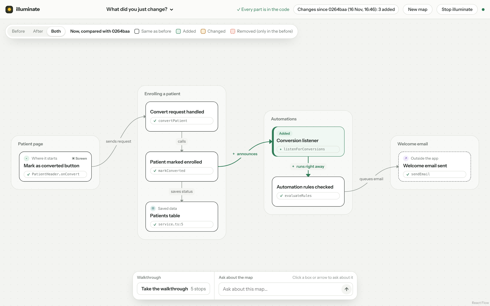
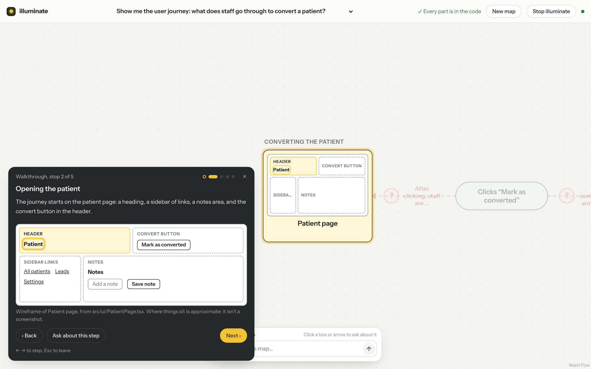

# illuminate

Ask Claude Code how your code works and get a map you can point at. Claude reads the repo and draws the answer as
boxes and arrows in your browser. A plain program then checks every box and arrow against the real code before you see
it, so the map can't show something that isn't there.


Design: [Codemap v1 Design](https://claude.ai/artifact/55L8tokprGe61qtfpDXJ5h).

## Install

In Claude Code (2.1.275 or later), in any repo:

```
/plugin install illuminate --marketplace johnz4021/illuminate
```

Then restart Claude Code. That's all: illuminate uses your own Claude Code session and sign-in, so there is no API key
to set up. It needs Node 20.19 or later. If Node is missing or too old, ask for a map anyway: Claude checks, offers to
install or update it, and tells you what to restart.

## What you can ask

Ask in plain words, or start with `/illuminate`. A map opens in your browser after about a minute. The screenshots
below are real maps of a small demo app (a clinic's patient system).

### 1. How something works

> What happens when a patient converts? Does the welcome email go out?

Claude follows the flow from where it starts to where it ends, across files. If something on the way should connect
and doesn't, the map shows it as a red dashed arrow, with the search that proves nothing is there. That is the map at
the top of this page: the app announces the conversion, and nothing is listening.

### 2. What a change did

> What did you just change?

The map shows the code as it is now, compared with a commit (the last one, unless you name another). What is new is
green, what is different is amber, and what was deleted is struck through in red. illuminate works those out itself
from the two versions. The switch at the top left shows the code before, after, or both.



Good for reading what an agent did after a long task. It compares with a commit, so work you hadn't committed before
the task counts as changed too.

### 3. A user journey

> Show me the user journey: what does staff go through to convert a patient?

Asked what a person sees or does, Claude draws screens, actions and choices from left to right, with no code on the
boxes. Each screen can show a wireframe of its page, drawn from the code, with the part the step is about marked.
Nothing has to be running.



### 4. A change before it's made

> How would we send the welcome email right away when a patient converts? Show me a plan.

Claude draws the code as it is, checked, with the proposal on top in violet: new boxes and arrows dashed, and what
would change marked. Nothing is edited. After the change is built, reopen the map and illuminate marks which proposed
parts are now in the code.


## On the map

- **Take the walkthrough.** A few stops, starting with the answer to your question.
- **Click any box or arrow** to see what it does and the code behind it.
- **Ask a follow-up** in the box at the bottom, or select something first and ask about that. The answer lights up the
  part of the map it's about.
- **Ask for a fix.** Claude proposes one, drawn on the map next to the exact change. Nothing is edited until you
  approve it.

The top bar says whether the map still matches the code ("Every part is in the code"). The check proves each part is
real; it doesn't prove the map covers everything.

## How it runs in Claude Code

illuminate runs as an MCP server in Claude Code: your session does the reading and writing, and illuminate checks every
claim and draws the map. Questions you ask on the map go to that same session, and the answers come back to the map.

Without the plugin: `claude mcp add --scope user illuminate -- npx -y @johnz4021/illuminate channel`. From a checkout of
this repo instead (for working on illuminate):

```
npm i && npm run build
claude mcp add --scope user illuminate -- node "$PWD/packages/server/bin/illuminate.mjs" channel
```

Once a map is ready, Claude keeps one `illuminate_listen` call open: after two minutes Claude Code moves it to the
background and gives you your terminal back, and when you ask on the map it wakes the session with your question. The
session has to stay open for that. Every 25 minutes or so the call returns and Claude quietly starts another (Claude
Code drops a call that has been quiet for 30 minutes); after about two hours with no questions, illuminate stops
listening. If a question on the map says Claude Code isn't listening, tell Claude "listen to illuminate". To skip
approving each illuminate tool call, allow its tools when Claude Code asks (`mcp__plugin_illuminate_illuminate__*` from
the plugin, `mcp__illuminate__*` otherwise).

Moving long tool calls to the background is on by default; if you've turned it off (`CLAUDE_CODE_MCP_AUTO_BACKGROUND_MS=0`),
listening holds your terminal until you ask on the map. Starting Claude Code with
`--dangerously-load-development-channels server:illuminate` is optional: it also pushes questions into the session
when nothing is listening.

Differences from the CLI: Claude works with your session's own tools and permissions, so the read-only tools and the
secret-file guard of the Agent SDK session aren't enforced, only asked for. Everything shown still passes the checker,
and fixes are still applied by illuminate only after you approve them.

## Use it from the command line (API key)

```
npm i
npm run build                                              # the viewer
npm run illume -- "What happens when a user signs up?" --repo /path/to/your/repo
```

It prints a link (`http://127.0.0.1:4317/m/<id>?t=<token>`) and opens it. illuminate stops on its own about 30 seconds after
you close its last tab (never while Claude is working), or when you press Stop illuminate on the page. Maps are saved in the target repo under
`.illuminate/maps/`; commit them to share. Other commands:

```
npm run illume -- open --repo <dir>            # maps already made in that repo
npm run illume -- check <map-id> --repo <dir>  # re-check a saved map against the code (exit 1 if a claim fails)
```

Options: `--port <n>` (default 4317), `--no-open`, `--model <id>` (default `claude-opus-5-5`, or `ILLUMINATE_MODEL`).

Claude access: an `ANTHROPIC_API_KEY` (a logged-in Claude Code also works for your own use, but don't hand illuminate to
others that way: Anthropic doesn't allow products on the Agent SDK to use people's claude.ai sign-in). To keep the key in a file,
`cp .env.example .env` at the root of this checkout and fill it in; the CLI loads it, and your shell's variables win.

To put `illuminate` on your PATH: `npm link -w @illuminate/server`.

### From a coding agent

`plugin/skills/illuminate/SKILL.md` is a skill in the standard `SKILL.md` format (the plugin installs it in Claude Code). Copy the `illuminate` folder into
`.claude/skills/` (Claude Code), `.agents/skills/` (Codex, Gemini CLI) or `.cursor/skills/` (Cursor). Your agent then
runs illuminate when you ask how something works, and hands you the link.

### Try it without a model

```
npm run preview
```

The real server and viewer on a throwaway copy of the care-app fixture, with a scripted stand-in for Claude. Nothing
is sent anywhere. Useful for UI work and demos.

### Screens on the map

When a flow starts from something you can see (a button, a form), Claude can put a picture of that screen on the box,
with the button marked. It decides case by case; backend-only maps get none. The usual picture is a wireframe of the
whole page, drawn from the code: its parts (top bar, sidebar, main area) with the one the step is about marked.
Nothing has to be running for that. illuminate checks that each part really belongs to the page and that its text is
in the code; where the parts sit is Claude's reading, so the wireframe says it is approximate. If your app is already
running on localhost, or the repo has an HTML file, illuminate can screenshot it instead with the Chrome you already
have, in a clean profile (pages behind a login show their login page, and Claude then falls back). illuminate never starts your app, and a screen is only shown if the checker
can tie it to the code. Screenshots are saved under `.illuminate/screens/`.

## How it works

What happens behind the four kinds of map above:

1. **Make a map.** A deterministic scan gives Claude a head start (entry points, routes, which requests hit which
   routes, which tables are written). Claude explores with Read/Grep/Glob only and returns the map in a fixed format.
2. **Check every claim.** `check()` re-reads each cited line, verifies calls, requests and imports against code facts,
   and re-runs the search behind every "nothing does X". Claude gets up to two rounds to fix what didn't hold. Anything
   still unconfirmed is shown with a "?", never hidden. The check proves each part is real code; it doesn't prove the
   map covers everything, and each gap shows the search behind it so you can judge that yourself.
3. **Explore.** The viewer draws areas, steps, labeled arrows and red dashed gaps, with a walkthrough Claude wrote. Select
   anything and ask, as a conversation: replies are short and lead with the answer, and the map does the explaining (each reply
   lights up what it's about). Claude explores further when the map isn't enough; what it finds is drawn only if it
   passes the checker.
4. **Fix from the map.** Ask for a change and Claude proposes a fix, drawn as a green dashed arrow next to the exact diff.
   Nothing changes until you approve. Then illuminate writes exactly that change (refusing if the files changed since),
   re-checks the map, and offers Undo.

## Packages

| Package | What it does |
| --- | --- |
| `@illuminate/facts` | What the code says, read deterministically: imports, symbols, calls, routes, table reads and writes, fetch → route links. TS/JS via oxc, Python and Go via tree-sitter. Carried over from the hackathon harness with its tests. |
| `@illuminate/core` | The map format (`parseMap`), the checker (`check`), map edits, and read-only repo access that never reads secrets. |
| `@illuminate/server` | The Claude map maker and explainer (Agent SDK, read-only tools, secret guard), fixes, the local HTTP/WebSocket server, and the `illume` CLI. |
| `@illuminate/viewer` | The React Flow + ELK viewer: the map, walkthrough, answers, fixes and the input bar. |

## Development

```
npm test           # every package (no model calls; Claude is scripted in tests)
npm run typecheck
npm run build      # the viewer bundle the server serves
```

`packages/core/test/fixtures/care-app` is the reference app: staff convert a patient, the app announces it, nothing
listens, so the welcome email never goes out. `care-app.map.json` is the map of that question.
